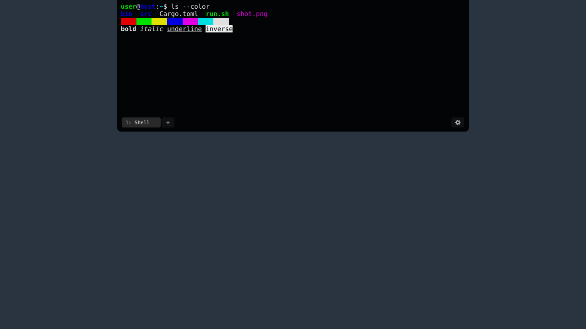

# wl-dropdown

**A drop-down terminal for Wayland, in the spirit of Yakuake.**
Bind one key to summon it over your desktop and dismiss it again. Tabs and running programs survive every round trip.



wl-dropdown is a single Rust binary that draws its own terminal on a
`wlr-layer-shell` surface — the mechanism bars and docks use — so it depends
on no desktop shell. It needs a compositor supporting layer-shell (Hyprland,
sway, river, niri…) and a key bound to `wl-dropdown toggle`.

## Features

- Tabbed terminal sessions, persisting across open/close, with renamable tabs
- Interactive scrollbar with drag and click-to-jump
- Resizable by dragging its side and bottom edges, until restart
- Mouse clicks go to programs that support them (htop, vim, mc…); Shift+drag still selects
- Right-click menu with Copy and Paste
- Terminal emulation by [alacritty_terminal](https://crates.io/crates/alacritty_terminal);
  key and mouse encoding checked byte-for-byte against libvterm's tables
- Drops down flush beneath a bar without hardcoding the bar's height
- Sharp text at fractional scales (`wp_fractional_scale_v1` + `wp_viewporter`)
- Click outside to dismiss; no shell or compositor plugin required
- Konsole/Yakuake colour schemes, and a theme layer for desktop palette engines
- Screenshot tests, at the renderer level and end-to-end against a real compositor

## How it works

| piece | what it does |
|---|---|
| `session` | one terminal: an `alacritty_terminal` grid fed by a pty, or headless for tests |
| `panel` | everything the QML panel and `TextRender` did — layout, hit-testing, input, animation, drawing — with no Wayland in it |
| `render`, `fonts` | a software renderer (tiny-skia + ab_glyph) drawing 1:1 to device pixels |
| `app` | the Wayland frontend: layer surface, keyboard, pointer, clipboard, scale |
| `settings`, `ini`, `colorscheme` | the layered configuration |
| `settings_ui` | the settings window (egui), run as a separate process |

Two details of the surface are load-bearing:

- **The surface spans the whole usable output, not just the terminal.** A
  surface sized to the terminal alone is never told about clicks that land
  elsewhere, so outside-click dismissal would be impossible. The area around
  the terminal is transparent and catches those clicks. Anchoring all four
  edges with an exclusive zone of `0` makes the compositor size the surface to
  the output *minus* everyone else's exclusive zones, which is why the terminal
  sits flush under a bar with no configured offset.
- **Keyboard interactivity is exclusive.** Under focus-follows-mouse, an
  on-demand surface loses the keyboard the moment the pointer drifts off it.
  Exclusive keeps input here while the terminal is mapped. Compositor keybinds
  still take priority, so the toggle works.

The consequence is that the dropdown is **modal**: while it is open, clicks
outside it dismiss it, and typing goes to the terminal.

## Installation

**Build dependencies**: Rust 1.95+, pkg-config, libxkbcommon. At run time the
settings window also loads libwayland-client and libEGL/libGL.

### Cargo

```bash
cargo install --path .
install -Dm644 share/templates/wl-dropdown.conf ~/.local/share/wl-dropdown/templates/wl-dropdown.conf  # optional
```

Build with `--no-default-features` to leave out the settings window (and its
GL dependency); the terminal is then configured by editing the INI files.

### NixOS (flake + home-manager)

```nix
inputs.wl-dropdown.url = "github:BlackPhlox/wl-dropdown";
```

```nix
imports = [ inputs.wl-dropdown.homeManagerModules.default ];

programs.wl-dropdown = {
  enable = true;
  settings = {
    widthPercent = 0.6;
    heightPercent = 0.3;
    fontFamily = "Hack";
    fontSize = 10.5;
  };
};
```

### Arch

A `PKGBUILD` for a `-git` package is in the repository root.

## Usage

`wl-dropdown` is a single binary. The first invocation starts it; later
invocations are remote controls over a per-user socket in `$XDG_RUNTIME_DIR`,
and do not connect to the display at all.

```bash
wl-dropdown toggle   # default
wl-dropdown show
wl-dropdown hide
wl-dropdown reload   # re-read configuration, including theme.conf
wl-dropdown settings # open the settings window
wl-dropdown -e htop  # run a program in a new tab, and show the terminal
```

Everything after `-e` is the program and its arguments, run from the directory
you ran `wl-dropdown` in. A single argument is handed to `sh -c`, so
`wl-dropdown -e "htop -d 5"` from a launcher works too. If wl-dropdown was not
running yet, the program gets the first tab rather than a second one beside an
idle shell.

`hide` and `reload` only ever talk to a running terminal; with none running
they do nothing rather than start one, so they are safe from hooks.

Bind the toggle in your compositor. Hyprland:

```
bind = , F12, exec, wl-dropdown toggle
```

## Configuration

Settings live in `$XDG_CONFIG_HOME/wl-dropdown/wl-dropdown.conf` (INI, keys
under `[General]`). The format is compatible with dropterm's, so an existing
`dropterm.conf` can be copied over.

| Key | Default | Meaning |
|---|---|---|
| `widthPercent` | `0.6` | Terminal width as a fraction of the usable area (0.2–1.0) |
| `heightPercent` | `0.3` | Terminal height as a fraction of the usable area (0.15–1.0) |
| `fontFamily` | `Hack` | Terminal font; falls back to an installed monospace font |
| `fontSize` | `10.5` | Point size |
| `shellProgram` | *(empty)* | Shell to run; empty uses the login shell from `passwd` |
| `foreground` | `#ebebeb` | Default text colour |
| `background` | `#000000` | Terminal background |
| `backgroundOpacity` | `0.92` | Background alpha (0.0–1.0) |
| `color0` … `color15` | *(libvterm's)* | The ANSI palette: 0–7 normal, 8–15 bright |
| `colorScheme` | *(empty)* | A Konsole/Yakuake colour scheme, by name or path |
| `cornerRadius` | `8` | Radius of the two free (bottom) corners |
| `animationMs` | `180` | Roll-down duration; `0` for instant |

Blur and the compositor's own open/close animation are compositor rules, on
the `wl-dropdown` layer namespace. Hyprland:

```
layerrule = blur, wl-dropdown     # blur behind the terminal
layerrule = noanim, wl-dropdown   # wl-dropdown animates the roll-down itself
```

### Where a setting comes from

Each key is resolved from the first of these that provides a usable value:

| | file | written by |
|---|---|---|
| 1 | `~/.config/wl-dropdown/wl-dropdown.conf` | wl-dropdown itself, when you change something |
| 2 | `~/.config/wl-dropdown/theme.conf` | a desktop theme engine (optional) |
| 3 | `~/.config/wl-dropdown/defaults.conf` | whatever installed wl-dropdown (optional) |
| 4 | — | built-in defaults |

Only the first is ever written by wl-dropdown. A value that does not parse —
`backgroundOpacity=` from a half-rendered template, say — falls through to the
next layer instead of winning. The settings window shows which layer each
colour came from, and clicking that label drops your override.

### Colour schemes

wl-dropdown reads Konsole's `.colorscheme` files, which Yakuake uses too:

```ini
[General]
colorScheme=ayu
```

A name is looked up as `<name>.colorscheme` in `~/.config/wl-dropdown/colorschemes/`,
then in `konsole/` under each XDG data directory (`~/.local/share/konsole/`,
`/usr/share/konsole/`, …). Anything containing a `/` is a path (a leading
`~/` is expanded). `[Foreground]`, `[Background]`, `[Color0]`…`[Color7]`,
`[Color0Intense]`…`[Color7Intense]` and `Opacity` are used.

The scheme's values sit directly beneath the file that named it: a scheme you
pick yourself beats the desktop theme, one declared in `defaults.conf` does
not, and a colour you set by hand wins either way. `colorScheme=` (empty) in
your own file turns off a scheme declared further down.

### Following a desktop colour scheme

Write `~/.config/wl-dropdown/theme.conf` and run `wl-dropdown reload`. A
template for [noctalia](https://noctalia.dev)'s template engine ships in
`share/templates/wl-dropdown.conf`:

```toml
[theme.templates.user.wl-dropdown]
input_path  = ".../share/wl-dropdown/templates/wl-dropdown.conf"
output_path = "~/.config/wl-dropdown/theme.conf"
post_hook   = "wl-dropdown reload"
```

## Keyboard shortcuts

| Shortcut | Action |
|---|---|
| Ctrl+Shift+C, or right-click → Copy | Copy |
| Ctrl+Shift+V, Shift+Insert, or right-click → Paste | Paste |
| Ctrl+Shift+T / N | New tab |
| Ctrl+Shift+W | Close tab |
| Ctrl+Shift+E | Rename tab (or right-click it) |
| Shift+Left, Ctrl+Shift+Tab | Previous tab ¹ |
| Shift+Right, Ctrl+Tab | Next tab ¹ |
| Ctrl+Shift+Left | Move tab left ¹ |
| Ctrl+Shift+Right | Move tab right ¹ |

Right-clicking the terminal opens a menu with Copy and Paste; Copy is
greyed out without a selection, and the selection is kept so the menu can
copy it. In a program that tracks the mouse (htop, vim with `mouse=a`),
right-clicks go to the program; hold Shift to get the menu, as with
selecting. Right-clicking a tab still renames it.

¹ Remappable with `previousTabKeys`, `nextTabKeys`, `moveTabLeftKeys` and
`moveTabRightKeys`: comma-separated key combinations in Qt's spelling
(`Ctrl+PgUp`, `Alt+Right`, `Meta+1`). Empty unbinds the action, handing the
key back to the program in the terminal. Switching wraps around; moving stops
at either end.

## Testing

```bash
cargo test                                   # everything below except e2e
UPDATE_SNAPSHOTS=1 cargo test --test screenshots   # accept intended visual changes
scripts/e2e-screenshot.sh                    # against a real compositor
```

- **Unit tests** cover configuration layering, INI and colour-scheme parsing,
  CLI and IPC, key and mouse encoding (checked against libvterm's tables),
  tab bookkeeping, the line editor, and real pty sessions.
- **Behaviour tests** (`tests/panel.rs`) drive the panel through the same
  entry points as the Wayland frontend: clicks on tabs, the gear and the
  backdrop, the right-click menu, edge resizing, the scrollbar, renaming,
  shortcuts, the wheel,
  mouse reporting, clipboard effects and program exit.
- **Screenshot tests** (`tests/screenshots.rs`) render deterministic scenes
  (`src/scenes.rs`) with bundled fonts and compare them pixel by pixel with
  `tests/snapshots/*.png`. On a mismatch the actual image and a diff (changed
  pixels in red) are written to `target/snapshots/`.
- **End-to-end screenshots** (`scripts/e2e-screenshot.sh`) start a headless
  sway, run the real binary with a fixed program in it, capture the output
  with grim at scales 1 and 1.25, and compare with `tests/e2e/*.png`.

To look at the scenes, or compare any two screenshots (for instance two grim
captures before and after a change):

```bash
cargo run --features snapshot-tool --bin wl-dropdown-snapshot -- render --backdrop 2a3340
cargo run --features snapshot-tool --bin wl-dropdown-snapshot -- diff after.png before.png --out diff.png
```

## Coming from dropterm

Configuration and key bindings are compatible; copy your `dropterm.conf` over.
The differences:

- Names: the binary, config directory, socket and layer namespace are
  `wl-dropdown`.
- Pasting uses bracketed paste when the program asks for it.
- Right-clicking the terminal opens a Copy/Paste menu.
- Clicks on the panel's own padding no longer dismiss it; only clicks outside
  the panel do.
- Programs cannot read the clipboard through OSC 52 (writing to it works).
- The SGR blink attribute and DECSCNM reverse video are not rendered;
  alacritty_terminal does not track them.

## License

MIT — see [LICENSE](LICENSE). Derived from [dropterm](https://github.com/ajunca/noctalia-dropdown-terminal) by ajunca, also MIT.
The DejaVu fonts in `tests/fonts` are under their own licence.
